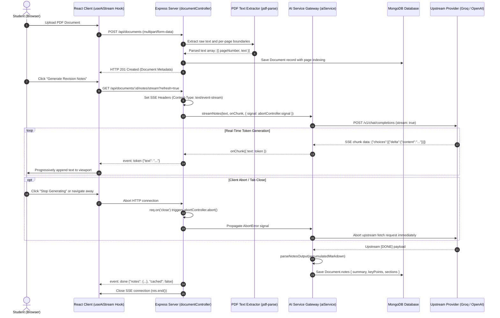

# FileSense: Document Intelligence and Active Recall Engine

[](https://github.com/luv2501/AI-Student-Learning-Platform/actions/workflows/ci.yml)
[](https://nodejs.org/)
[](https://opensource.org/licenses/MIT)

A full-stack document intelligence workspace that transforms unstructured academic PDFs into structured revision materials, interactive Q&A with ground-truth page citations, SuperMemo SM-2 spaced repetition flashcards, knowledge gap remediation quizzes, and timezone-aware study streak tracking.

---

## Table of Contents

- [Overview](#overview)
- [Feature Highlights](#feature-highlights)
- [System Architecture](#system-architecture)
- [Request Flow & Lifecycle](#request-flow--lifecycle)
- [Tech Stack & Engineering Decisions](#tech-stack--engineering-decisions)
- [Engineering Deep-Dives](#engineering-deep-dives)
  - [1. PDF Stream Chunking & Text Extraction Heuristics](#1-pdf-stream-chunking--text-extraction-heuristics)
  - [2. Real-Time SSE Token Streaming with Upstream Disconnect Cancellation](#2-real-time-sse-token-streaming-with-upstream-disconnect-cancellation)
  - [3. SuperMemo SM-2 Algorithm & Deterministic Card Hashing](#3-supermemo-sm-2-algorithm--deterministic-card-hashing)
  - [4. Timezone-Aware Streak Continuity across Day Boundaries](#4-timezone-aware-streak-continuity-across-day-boundaries)
  - [5. Knowledge Gap Analysis Algorithm](#5-knowledge-gap-analysis-algorithm)
- [API Reference](#api-reference)
- [Setup & Configuration](#setup--configuration)
  - [Prerequisites](#prerequisites)
  - [Installation](#installation)
  - [Environment Variables](#environment-variables)
  - [Running Locally](#running-locally)
- [Testing & Quality Assurance](#testing--quality-assurance)
- [License](#license)

---

## Overview

Traditional study platforms treat documents as static files. Students spend hours manually summarizing lectures, copy-pasting notes into external flashcard software, and guessing what concepts they have failed to retain.

**FileSense** (formerly StudyMind) unifies document ingestion, generative synthesis, and cognitive science workflows into an integrated cockpit:
- **Instant Document Ingestion**: Upload academic PDFs up to 25 MB with automatic per-page text indexing and keyword extraction.
- **Progressive Streaming**: Server-Sent Events (SSE) deliver real-time token generation for revision notes and answers with zero UI freeze.
- **Verifiable Ground Truth**: Q&A queries return exact page citations and contextual passage excerpts, eliminating LLM hallucinations.
- **Active Recall Engine**: SuperMemo SM-2 scheduling calculates review intervals based on self-reported recall difficulty.
- **Automated Gap Remediation**: Practice quizzes analyze performance per concept, isolating weak spots (< 60% accuracy) for targeted 5-question review quizzes.
- **Habit Formation**: Built-in Pomodoro focus timer with audio cues and timezone-aware daily streak calculations.

---

## Feature Highlights

### 1. Dashboard & Focus Cockpit
Central command center tracking library inventory, pending tasks, study streaks, today's focus minutes, and 7-day interactive focus and quiz trend visualizers.


### 2. Document Workspace & Real-Time SSE Streaming
High-utility document reader with side-by-side study panels. Notes and answers stream progressively via Server-Sent Events with an instant "Stop generating" abort trigger and verified page citations.


### 3. Scientific Spaced Repetition (SuperMemo SM-2)
Active recall card engine with four distinct review ratings (Again, Hard, Good, Easy), dynamic interval previews, and persistent due-date scheduling across document regenerations.


### 4. Quiz History & Knowledge Gaps Detection
Interactive multiple-choice practice engine tracking quiz attempts over time. Automatically identifies underperforming topics and launches targeted 5-question remedial quizzes.


### 5. Pomodoro Focus Timer & Timezone-Aware Streaks
Configurable focus sessions (Pomodoro 25m, Short Break 5m, Long Break 15m) with minimal circular progress tracks, live document tab title counters, Web Audio chimes, and timezone-adjusted daily streak continuity.


---

## System Architecture

The following diagram illustrates the high-level architecture of FileSense, detailing client-server boundaries, authentication, data persistence, and external LLM gateway connectivity:

```mermaid
flowchart TD
    subgraph ClientLayer["Frontend Client (React 18 + Vite)"]
        UI["UI Chrome & Panels (Public Sans + Geist Mono)"]
        StreamHook["useAiStream Hook (fetch + ReadableStream)"]
        ThemeEngine["Theme Engine (Blocking Zero-FOUC Script)"]
    end

    subgraph ServerLayer["Backend API Gateway (Node.js 20 + Express)"]
        Router["Modular Router (/api/*)"]
        AuthMiddleware["JWT Authentication & Rate Limiting"]
        DocController["Document & PDF Text Controller"]
        StreamController["SSE Streaming Controller (text/event-stream)"]
        StudyController["Spaced Repetition & Quiz Analytics"]
        TimerController["Streak & Focus Timer Engine"]
        AIService["AI Service Gateway (Chunking, Prompts, SSE Parse)"]
    end

    subgraph DataLayer["Persistence & Infrastructure"]
        MongoDB[("MongoDB Database (Atlas / In-Memory)")]
        DiskStorage[("PDF Local Storage (server/uploads)")]
    end

    subgraph ExternalServices["External LLM Provider"]
        GroqGateway["Groq / OpenAI Compatible API (/v1/chat/completions)"]
    end

    UI -->|HTTP / REST| Router
    StreamHook -->|SSE Stream Connection| StreamController
    Router --> AuthMiddleware
    AuthMiddleware --> DocController
    AuthMiddleware --> StreamController
    AuthMiddleware --> StudyController
    AuthMiddleware --> TimerController

    DocController -->|Store File| DiskStorage
    DocController -->|Save Extracted Pages| MongoDB
    StudyController -->|Read / Write Reviews & Attempts| MongoDB
    TimerController -->|Read / Write Sessions & Streaks| MongoDB

    StreamController --> AIService
    AIService -->|Stream Request (stream: true)| GroqGateway
    GroqGateway -->|Progressive SSE Tokens| AIService
    AIService -->|Stream Token Chunks| StreamController
    StreamController -->|event: token / event: done| StreamHook
    AIService -->|Cache Notes & History| MongoDB
```

---

## Request Flow & Lifecycle

The following sequence diagram details the end-to-end lifecycle of a document upload followed by an SSE streaming generation request with client cancellation support:



---

## Tech Stack & Engineering Decisions

| Layer | Technology | Architectural Justification |
| :--- | :--- | :--- |
| **Frontend Framework** | React 18 + Vite | Fast HMR, minimal bundle overhead (~340ms production builds), strict component isolation. |
| **Design System** | Tailwind CSS v4 + Semantic Tokens | Custom CSS variable tokens (`--bg-base`, `--bg-surface`, `--text-primary`) with zero runtime styling overhead and micro-radii tokens (`2px` to `12px`). |
| **Typography** | Public Sans + Geist Mono | High-legibility editorial grotesque for body and UI chrome, paired with monospaced precision for timestamps, metrics, and page counts. |
| **Streaming Protocol** | Server-Sent Events (SSE) | Superior to WebSockets for unidirectional LLM token streaming. Operates over standard HTTP/1.1 and HTTP/2 without persistent daemon socket management. |
| **Data Visualizations** | Native Vanilla SVG | Eliminates heavy external chart libraries (Recharts / Chart.js). Handcrafted SVG components ensure zero layout shifts, instant rendering (< 5 KB), and token fidelity in both light and dark themes. |
| **Backend Architecture** | Node.js 20+ & Express | Non-blocking asynchronous I/O optimized for concurrent stream piping and file buffer processing. |
| **Database & ODM** | MongoDB Atlas & Mongoose | Document-oriented storage naturally models hierarchical note trees, multi-page PDF indices, and append-only quiz attempts with compound indexing. |
| **Spaced Repetition** | SuperMemo SM-2 Engine | Mathematically proven active recall decay curve balancing retention efficiency against review fatigue. |
| **Testing Infrastructure** | In-Memory MongoDB (`mongodb-memory-server`) | Enables 100% test isolation with zero external database dependencies, running all 9 suites in under 15 seconds in CI environments. |
| **AI Gateway** | OpenAI-Compatible REST Interface | Provider-agnostic abstraction defaulted to Groq `openai/gpt-oss-20b` for sub-second inference speeds. |

---

## Engineering Deep-Dives

### 1. PDF Stream Chunking & Text Extraction Heuristics

Academic PDFs frequently contain figures, footnotes, multi-column layouts, and varying token lengths. Simply dumping 50 pages into an LLM prompt degrades output quality, exceeds context limits, and escalates API costs.

FileSense solves this through a multi-stage ingestion pipeline in [`pdfService.js`](file:///d:/Projects/AI-Student-Learning-Platform/server/src/services/pdfService.js) and [`aiService.js`](file:///d:/Projects/AI-Student-Learning-Platform/server/src/services/aiService.js):
- **Per-Page Structural Indexing**: Extracts text page-by-page, recording exact page numbers (`pages: [{ pageNumber, text }]`) while stripping non-printable binary artifacts.
- **Paragraph-Boundary Chunking**: Splits extracted document text along natural paragraph boundaries (`\n\s*\n`), targeting ~8,000 characters per chunk with a strict 10-chunk ceiling.
- **Relevance & Density Ranking**: Implements term-frequency weighting (`rankDenseChunks` and `rankPagesByQuery`) filtering out stop words to surface the top informative pages matching the student's question before assembling the final LLM prompt context.

### 2. Real-Time SSE Token Streaming with Upstream Disconnect Cancellation

LLM generation for detailed revision notes can take 5 to 15 seconds. Without streaming, users face blank screens and spinners. However, streaming naive HTTP chunks risks zombie processes if the user disconnects mid-stream.

FileSense implements an end-to-end cancellation pipeline:
- **SSE Event Protocol**: Streams three explicit event types:
  - `event: token`: Emits progressive token deltas (`{"text": "..."}`).
  - `event: done`: Emits the finalized structured payload (`{"notes": {...}, "cached": boolean}`).
  - `event: error`: Emits user-friendly error messages if validation fails.
- **Immediate Upstream Cancellation**: The Express handler attaches an `AbortController` to the client connection (`req.on('close')`). If the student clicks "Stop generating" or closes their tab, the abort signal is instantly forwarded to the upstream Groq `fetch` request, terminating inference immediately and eliminating wasted token spend.
- **Delimiter Shielding**: In Q&A streams, answers and citations are streamed in one pass. The backend buffers tokens near the citation boundary (`---CITATIONS---`), emitting clean answer tokens to the student while isolating citation metadata for structured delivery in the `done` event.

### 3. SuperMemo SM-2 Algorithm & Deterministic Card Hashing

Standard flashcard apps store review status on ephemeral card IDs. If an AI generator rewrites or regenerates flashcards for a document, past review history is typically lost.

FileSense pairs a clean implementation of the SuperMemo SM-2 algorithm with deterministic hashing:
- **Mathematical SM-2 Engine**: Evaluates four student recall grades:
  - `1: Again` (Complete blackout; interval resets to 1 day, ease factor penalized by -0.20)
  - `2: Hard` (Recalled with hesitation; interval advances to 1.2x, ease factor penalized by -0.15)
  - `3: Good` (Correct recall; standard SM-2 interval multiplier)
  - `4: Easy` (Immediate recall; interval advances with bonus multiplier, ease factor boosted by +0.15)
  - **Ease Factor Floor**: Bounded at `EF >= 1.30` to prevent cards from falling into inescapable review traps.
- **Deterministic Card Identity (SHA-256)**: Rather than relying on transient Mongo ObjectIDs, each card is assigned a unique `cardId` derived from the SHA-256 hash of its normalized question text (`crypto.createHash('sha256').update(normalizedQuestion).digest('hex').slice(0, 16)`). When a student regenerates materials for an updated lecture PDF, historical review progress for existing concepts remains intact.

### 4. Timezone-Aware Streak Continuity across Day Boundaries

Tracking daily study streaks across midnight boundaries is notoriously prone to timezone bugs when evaluated in UTC. A student studying at 11:30 PM in London or Los Angeles must not have their streak broken or double-incremented by UTC rollover.

FileSense implements localized calendar arithmetic in [`streak.js`](file:///d:/Projects/AI-Student-Learning-Platform/server/src/utils/streak.js):
- **Client Timezone Extraction**: Every timer completion and study interaction transmits the user's IANA timezone identifier via the `x-user-timezone` request header (e.g., `Europe/London`, `America/New_York`).
- **Standardized Local Date Strings**: Converts timestamps to localized calendar dates (`YYYY-MM-DD`) using `Intl.DateTimeFormat('en-CA', { timeZone })`.
- **Three-State State Machine**:
  - *Same-Day Activity*: If `today === lastActiveDate`, the streak is maintained without redundant increments.
  - *Consecutive Day Activity*: If `yesterday === lastActiveDate`, the streak increments by `+1`, updating `longestStreak` if a new milestone is achieved.
  - *Broken Habit*: If more than 1 calendar day has elapsed, the streak resets cleanly to `1`.

### 5. Knowledge Gap Analysis Algorithm

Taking practice quizzes without remediation results in repetitive review of concepts the student has already mastered.

FileSense continuously identifies weak spots through historical attempt aggregation in [`quizController.js`](file:///d:/Projects/AI-Student-Learning-Platform/server/src/controllers/quizController.js):
- **Topic Tagging**: Every question generated by the AI includes a concise concept tag (e.g., `Cellular Respiration`, `Light Reactions`).
- **Accuracy Thresholding**: Aggregates all user quiz attempts across documents. Any topic meeting either of two criteria is flagged as an active knowledge gap:
  1. Cumulative topic accuracy falls below `60%`.
  2. The student has incorrectly answered questions on the topic `2 or more times`.
- **Targeted Remediation**: The student can launch an on-demand, 5-question targeted practice quiz specifically addressing their detected weak spots with 1-click execution.

---

## API Reference

| Method | Endpoint | Auth | Description |
| :--- | :--- | :--- | :--- |
| `GET` | `/api/health` | No | System health check and database connectivity status. |
| `POST` | `/api/auth/register` | No | Registers student account; returns JWT session token. |
| `POST` | `/api/auth/login` | No | Authenticates student credentials; returns JWT session token. |
| `GET` | `/api/auth/me` | Yes | Retrieves authenticated user profile, timezone, and study statistics. |
| `PUT` | `/api/auth/me` | Yes | Updates user profile details or changes password. |
| `POST` | `/api/documents` | Yes | Uploads a PDF (up to 25 MB) and extracts per-page text indices. |
| `GET` | `/api/documents` | Yes | Lists all documents owned by the student. |
| `GET` | `/api/documents/:id` | Yes | Retrieves a single document with cached notes and flashcards. |
| `DELETE` | `/api/documents/:id` | Yes | Deletes a document with cascade removal of cards, attempts, and history. |
| `POST` | `/api/documents/:id/notes` | Yes | Generates or fetches cached structured revision notes. |
| `GET` | `/api/documents/:id/notes/stream`| Yes | Real-time SSE stream for revision notes with progressive token emission. |
| `POST` | `/api/documents/:id/flashcards` | Yes | Generates structured flashcards for the document. |
| `GET` | `/api/documents/:id/flashcards/reviews` | Yes | Retrieves persistent SM-2 review progress for document cards. |
| `POST` | `/api/flashcards/review` | Yes | Submits SM-2 recall rating (1: Again, 2: Hard, 3: Good, 4: Easy). |
| `GET` | `/api/flashcards/due` | Yes | Retrieves all cards due for active recall review across library. |
| `GET` | `/api/flashcards/due-count` | Yes | Returns total count of cards due today for dashboard badge. |
| `POST` | `/api/documents/:id/quiz` | Yes | Generates a 5-question multiple choice practice quiz. |
| `GET` | `/api/documents/:id/quizzes/attempts` | Yes | Retrieves attempt history and document weak spots. |
| `POST` | `/api/quizzes/attempts` | Yes | Persists completed quiz score and answer breakdown. |
| `GET` | `/api/quizzes/weak-spots` | Yes | Aggregates user knowledge gaps across all documents. |
| `POST` | `/api/quizzes/weak-spots` | Yes | Generates a 5-question targeted remedial quiz for active weak spots. |
| `POST` | `/api/documents/:id/ask` | Yes | Q&A endpoint returning answer and grounded page citations. |
| `POST` | `/api/documents/:id/ask/stream` | Yes | Real-time SSE stream for Q&A with progressive tokens and citations. |
| `GET` | `/api/documents/:id/ask/history`| Yes | Retrieves stored conversation thread for the document. |
| `DELETE` | `/api/documents/:id/ask/history`| Yes | Clears conversation thread history for the document. |
| `POST` | `/api/timer/session` | Yes | Records completed Pomodoro focus session and advances streak. |
| `GET` | `/api/timer/stats` | Yes | Returns active streak, today minutes, total time, and 7-day breakdown. |
| `GET` | `/api/tasks` | Yes | Retrieves student task list with optional status and tag filters. |
| `POST` | `/api/tasks` | Yes | Creates a new study task. |
| `PATCH`| `/api/tasks/:id/toggle` | Yes | Toggles task completion state and triggers streak progression. |
| `DELETE`| `/api/tasks/:id` | Yes | Removes a task from the student workspace. |

---

## Setup & Configuration

### Prerequisites
- **Node.js**: `v20.0.0` or higher
- **npm**: `v9.0.0` or higher
- **MongoDB**: Local MongoDB instance or MongoDB Atlas connection string
- **AI API Key**: Groq API key (default) or any OpenAI-compatible API key

### Installation

Clone the repository and install all dependencies across root, server, and client:

```bash
git clone https://github.com/luv2501/AI-Student-Learning-Platform.git
cd AI-Student-Learning-Platform
npm run install:all
```

### Environment Variables

Copy the example environment files:

```bash
cp server/.env.example server/.env
cp client/.env.example client/.env
```

Configure your environment settings in `server/.env`:

| Variable | Description | Default / Example | Required |
| :--- | :--- | :--- | :--- |
| `PORT` | Backend server port | `5000` | No |
| `NODE_ENV` | Application environment (`development` / `production` / `test`) | `development` | No |
| `MONGO_URI` | MongoDB connection string | `mongodb://localhost:27017/filesense` | Yes |
| `JWT_SECRET` | Secret key for signing JSON Web Tokens (min 32 characters) | `your_secure_random_jwt_secret_key` | Yes |
| `AI_API_KEY` | API key for Groq or OpenAI-compatible completion provider | `gsk_...` | Yes (for AI) |
| `AI_BASE_URL` | Base URL for the completions API (must end in `/v1`) | `https://api.groq.com/openai/v1` | No |
| `AI_MODEL` | LLM model identifier | `openai/gpt-oss-20b` | No |
| `AI_AUTH_STYLE` | Authorization header style (`bearer` or `api-key`) | `bearer` | No |

Configure client settings in `client/.env`:

| Variable | Description | Default / Example | Required |
| :--- | :--- | :--- | :--- |
| `VITE_API_URL` | Base API URL (leave empty in local dev to use Vite proxy) | `""` | No |
| `VITE_PROXY_TARGET` | Backend target URL for Vite development server proxy | `http://localhost:5000` | No |

### Running Locally

Start both backend API and frontend client concurrently:

```bash
npm run dev
```

- Frontend client runs at: `http://localhost:5173`
- Backend API runs at: `http://localhost:5000`
- API health check: `http://localhost:5000/api/health`

---

## Testing & Quality Assurance

FileSense features an automated verification pipeline containing **9 dedicated test suites** and **353 test assertions**. All server tests utilize an in-memory MongoDB engine (`mongodb-memory-server`), ensuring zero external database dependencies and zero data pollution.

### Run All Test Suites

Execute the unified test runner to run all suites sequentially and print an ASCII summary table:

```bash
npm test
```

### Verified Test Suite Breakdown

```
========================================================================================
FileSense — Unified Server Test Runner
========================================================================================

Suite                                         Status       Passed   Failed     Duration
----------------------------------------------------------------------------------------
test-api.js (Auth, Health & Profile Security) PASSED         27        0        1.69s
test-tasks.js (Tasks Engine, Timezones)       PASSED         42        0        1.61s
test-documents.js (Document Upload & PDF)     PASSED         40        0        1.69s
test-ai.js (AI Chunking, Retry & Generation)  PASSED         23        0        1.16s
test-citations.js (Page Citations & History)  PASSED         40        0        1.51s
test-spaced-repetition.js (SM-2 Flashcards)   PASSED         46        0        1.40s
test-quiz-history.js (Quiz History & Gaps)    PASSED         38        0        1.42s
test-streaming.js (SSE Streaming & Aborts)    PASSED         42        0        1.75s
test-streaks-timer.js (Streaks & Focus Timer) PASSED         55        0        1.33s
----------------------------------------------------------------------------------------
TOTAL: 9 suites, 353 passed, 0 failed                                    13.55s
========================================================================================
```

### Verify Production Client Build

Compile the React 18 production bundle via Vite to verify asset chunking and zero syntax/type errors:

```bash
npm run build:client
```

---

## License

This project is licensed under the MIT License. See the [LICENSE](LICENSE) file for details.
